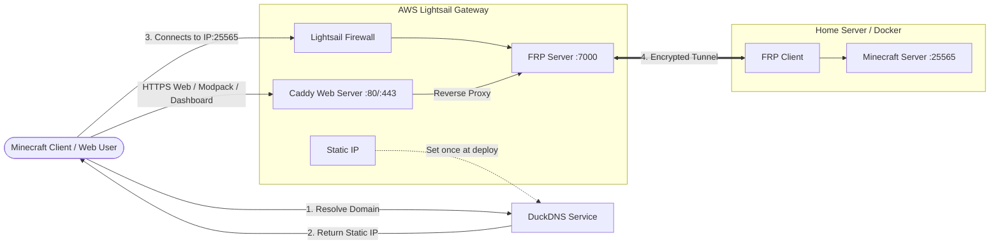

# Hybrid Cloud Minecraft Infrastructure

This project deploys a secure Minecraft server using a Hybrid Cloud Architecture.

Game Server: Runs locally, dockerized on your hardware.

Gateway: Runs on a cheap AWS Lightsail instance (provisioned with Terraform).

Tunnel: Traffic is securely tunneled (FRP) from the Cloud to your local.

Web Frontend: Serves a secure HTTPS server status page, a modpack download link, and a reverse-proxied management dashboard via Caddy.

## System Architecture



## Benefits

- Provides DDoS protection via AWS.
- Low cost (uses cheap cloud compute only for traffic forwarding).
- Hides your home IP address.
- Portable config (Infrastructure as Code).
- Zero-config SSL/HTTPS via Caddy.
- Automated Modpack distribution for seamless player onboarding.
- Secure, encrypted access to the FRP management dashboard.

## Repository Structure

cloud/ - Terraform code to provision the AWS Lightsail Gateway, Caddyfile, and static HTML templates.

local/ - Docker Compose files to run the Minecraft Server & Tunnel Client.

local/config-overrides/ - Game configuration (Whitelists, MOTD, etc.).

local/client-mods/ - Extra client-side `.jar` mods to be injected into the distributed modpack.

local/build-modpack.sh - Automation script to bundle the custom client modpack.

## Prerequisites

Terraform Installed: sudo apt install terraform

AWS CLI Installed: sudo apt install awscli

Docker & Compose: Installed on your local machine.

DuckDNS Account: A domain (e.g., "myserver.duckdns.org") and a Token.

AWS IAM User: With LightsailFullAccess permissions.

**Cost:** the gateway is a Lightsail `nano` instance, roughly US$5/month with a public IPv4 address (check current [Lightsail pricing](https://aws.amazon.com/lightsail/pricing/)). The static IP is free while attached.

<details> <summary>Custom IAM Policy - LightsailFullAccess</summary>

```json
{
	"Version": "2012-10-17",
	"Statement": [
		{
			"Effect": "Allow",
			"Action": ["lightsail:*"],
			"Resource": "*"
		}
	]
}
```

</details>

## Setup Guide

### Phase 1: The Cloud Gateway (AWS)

1. Configure credentials - Create a (preferably, named) profile for Terraform to use.

```bash
aws configure --profile "terraform-lightsail"
```

Set `aws_profile = "terraform-lightsail"` in `cloud/terraform.tfvars` (next step) to use it. Without it, Terraform uses your default AWS credentials.

2. Configure Terraform variables - Create your secret variables file.

```bash
cp cloud/terraform.tfvars.template cloud/terraform.tfvars
```

Edit cloud/terraform.tfvars and add your DuckDNS Token, Domain, and Dashboard credentials. The gateway defaults to `eu-west-2` (London); set `aws_region` and `availability_zone` to use a region closer to your players.

3. Deploy Infrastructure - Terraform will provision the server, install Docker, set up Caddy, start the tunnel server and point your DuckDNS domain at the gateway's static IP. Review the plan and type `yes`. Create `local/.env` first (Phase 2, step 1): the first deploy also builds the client modpack, which needs your CurseForge settings.

```bash
make cloud-deploy
```

Changing the Caddyfile, status page, image versions or any secret re-provisions the gateway in place on the next `make cloud-deploy`.

Verify: The public_ip output matches the IP on your DuckDNS dashboard.

Note: Terraform generates an SSH key (id_rsa.pem) in the cloud/ folder, and the tunnel config (local/frpc.toml). Keep these private.

> **Keep `cloud/terraform.tfstate` private.** Terraform state stores your tokens, dashboard password and the gateway's SSH private key in plain text. It is git-ignored; never commit or share it.

### Phase 2: The Game Server (Local)

1. Configure the server - world folder, modpack and secrets.

```bash
cd local
cp .env.template .env
```

Edit .env and set `DATA_FOLDER`, `MODPACK_SLUG`, `CF_API_KEY`, `RCON_PASSWORD` and `RESTIC_PASSWORD` (all required). You can also set the container's memory/CPU limits and a server icon there.

2. Configure Game Rules & Whitelist - We use split configuration to keep secrets out of Git.

local/config-overrides/minecraft-public.env: (Commit this) Game rules, MOTD, Difficulty.

local/config-overrides/minecraft-private.env: (GitIgnored, optional) Whitelist, Ops, Sensitive settings.

3. Start the Server

```bash
make local-up
```

Check Logs: `make mc-logs` and `make frpc-logs`

Wait for: Done! (Server Ready) and [minecraft] start proxy success (Tunnel Ready).

Run `make` (or `make help`) to list all available commands.

### Phase 3: Modpack Distribution

To ensure your players have the exact mods and configs as your server:

1. Drop any extra client-side `.jar` files into `local/client-mods/`.
2. Deploy the modpack to the web server:

```bash
make deploy-modpack
```

This downloads the latest client pack for `MODPACK_SLUG` from the CurseForge API, adds your `config-overrides/` and client mods, and uploads the zip to the gateway. It also runs automatically when the gateway is first created.

Optionally, put a `favicon.ico` in `cloud/` for the status page (uploaded on the next `make cloud-deploy`).

Players can now visit `https://yourdomain.duckdns.org` to check server status and download the compiled modpack.

How to Connect
Server Address: yourdomain.duckdns.org

Port: Default (25565) - No port number needed in client.

## Management & Troubleshooting

### Accessing the FRP Dashboard

Your FRP tunnel traffic and connection health can be monitored securely via the web dashboard.

1. Navigate to `https://yourdomain.duckdns.org:7500`.
2. Log in using the `frp_dashboard_creds` defined in your `terraform.tfvars` file.

### SSH Access to Cloud Gateway

Terraform generates a keypair automatically. To debug the cloud server:

```bash
make cloud-ssh
```

### Managing Players (Ops/Whitelist)

**Do not use in-game commands like /whitelist add as they will be overwritten on restart.**

Edit local/config-overrides/minecraft-private.env.

Add names to OPS= or WHITELIST=.

Apply changes:

```bash
make local-up
```

### How to Change Modpacks

Switching from one modpack to another requires clearing old mod files while preserving your world data.

1. Stop the server: `cd local && docker compose down`
2. Update `MODPACK_SLUG` and `DATA_FOLDER` in your `.env` file to point to the new pack.
3. Run `make deploy-modpack` to update the web download.
4. Start the server: `make local-up`

### Updating the Server and Modpack

```bash
make mc-update
```

This takes a manual backup, pulls the latest `itzg/minecraft-server:java21` image and restarts the server, which installs the newest version of the modpack. Once the server is up it updates the version shown on the status page. Run `make deploy-modpack` afterwards so players can download the matching client pack.

### Dependency Updates

The gateway images (Caddy, frps), the local frpc and backup images, and the Terraform providers are pinned to exact versions. [Renovate](https://docs.renovatebot.com/) keeps them current: install the [Renovate GitHub app](https://github.com/apps/renovate) on your fork and it opens a PR each week when something has an update (frps and frpc are always bumped together). To apply one:

1. Merge the PR and pull it locally.
2. Gateway images or providers: run `make cloud-deploy`.
3. Local images: run `make local-up`.

The server image itself follows the rolling `java21` tag and is updated with `make mc-update` instead.

### Backups

The `backup` container takes an encrypted [restic](https://restic.net/) snapshot of the world every hour and keeps 7 days of them, in `local/backups/<DATA_FOLDER>/`. `make mc-backup` (also run by `make mc-update`) additionally writes a full tarball to `local/manual-backups/`.

Backups are stored on the same disk as the server. For protection against disk failure, change the `./backups` volume in `local/docker-compose.yml` to a path on another drive (or sync `local/backups/` elsewhere). Keep your `RESTIC_PASSWORD`: backups can't be restored without it.

### How to Restore World Backups

To restore the latest snapshot (replace `atm10` with your `DATA_FOLDER`):

```bash
cd local
docker compose down
docker compose run --rm --no-deps --entrypoint restic -v "$PWD/restore:/restore" backup restore latest --target /restore
mv instances/atm10 instances/atm10.old
sudo mv restore instances/atm10
cd .. && make local-up
```

To restore an older snapshot, list them by replacing `restore latest --target /restore` with `snapshots`, then use the snapshot ID instead of `latest`.

To restore a manual tarball instead, stop the server, move `local/instances/<DATA_FOLDER>` aside and run `tar -xzf local/manual-backups/backup_<date>.tar.gz` from the repo root.

### Common Issues

"Connection Refused": Check if the Tunnel is up (`make frpc-logs`).

"Unknown Host": DNS propagation lag. Wait 5 mins or try the raw IP.

Wrong IP in DuckDNS: Re-run the gateway setup, which sets DuckDNS again: `cd cloud && terraform apply -replace=null_resource.server_setup`.
